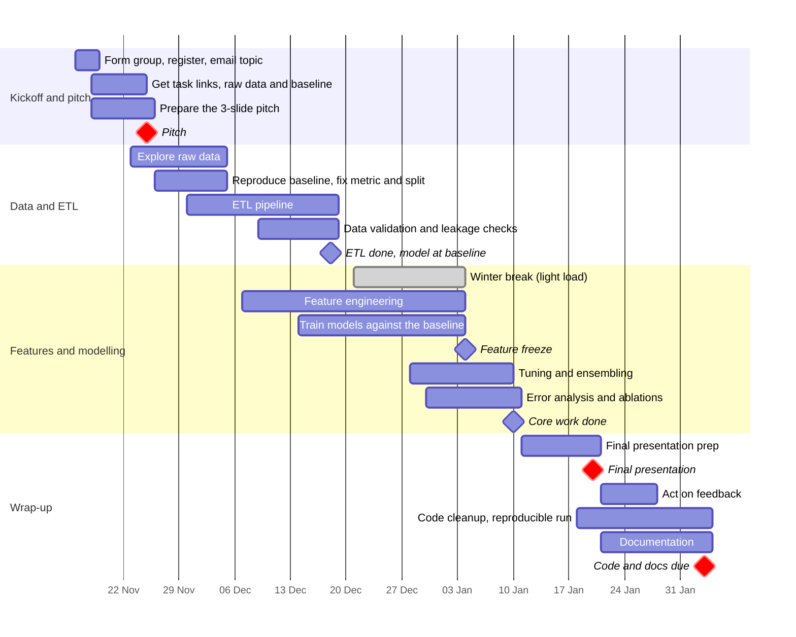

# deml-dbahn

Group project for DEML 2026 at TU Berlin (WildMLBench track).

**Goal:** build an end-to-end ML pipeline that predicts Deutsche Bahn train delays from raw data, with our own ETL and feature engineering, and beat the baseline provided by the course.

## Getting started

1. Clone the repo.
2. Download the course data (link in our team chat) into `data/`, so it contains `training.tar`, `val.tar`, `weather.tar`, `stations.json`, `timetables_schema.json` and `val_questions.csv`. Put the course's `scoring/` folder in the repo root.

`data/` and `scoring/` are git-ignored. Never commit course data or the val answers: this repo is public.

### Table formats

All column names and types are fixed in [`src/schema.py`](src/schema.py). Write every table with `table_path(split, table)`, which gives `data/processed/<split>/<table>.parquet`. To change a column, open a pull request to `src/schema.py` so everyone sees it.

Predictions are a CSV with the columns `question_id` and `prediction` (arrival delay in minutes, early is negative), one row per question.

### Reporting your work

Each task has one file in [`docs/`](docs/) with four headings: what was done, decisions and why, results, open issues. Keep your task's file up to date as you go, in your own words: the course does not accept AI-generated documentation. Exploration notebooks go in `notebooks/` and are linked from the docs file.

## Deadlines

| Date | What |
|---|---|
| 18 Nov 2026 | Group formation and project selection |
| 25 Nov 2026 | Pitch presentation (5 min talk + 10 min questions) |
| 20 Jan 2027 | Final presentation (10 min talk + 12 min questions) |
| 3 Feb 2027 | Code and documentation |

Internal checkpoints: ETL done and first model at least matching the baseline by **18 Dec**, feature freeze on **4 Jan**, tuning and error analysis done by **10 Jan**. 11–19 Jan is buffer and presentation prep.

## Timeline

## Weekly plan

| Week | Dates | Focus |
|---|---|---|
| 1 | 16–22 Nov | Form the group, get data access and the baseline, start the pitch |
| 2 | 23–29 Nov | Pitch; first pass over the raw data; reproduce the baseline |
| 3 | 30 Nov–6 Dec | Finish data exploration; fix metric and time-based split; start ETL |
| 4 | 7–13 Dec | Core ETL: parse, clean, normalize stations and timestamps, join; first features |
| 5 | 14–20 Dec | Validation and leakage checks; first model vs. baseline |
| 6–7 | 21 Dec–3 Jan | Winter break, light load: finish features and training runs; start tuning and error analysis |
| 8 | 4–10 Jan | Feature freeze; finish tuning, ensembling, error analysis and ablations |
| 9 | 11–17 Jan | Buffer; prepare final presentation |
| 10 | 18–24 Jan | Final presentation; start cleanup and docs |
| 11 | 25–31 Jan | Act on feedback; reproducible pipeline; write docs |
| 12 | 1–7 Feb | Final run from a clean checkout; submit code and docs |
